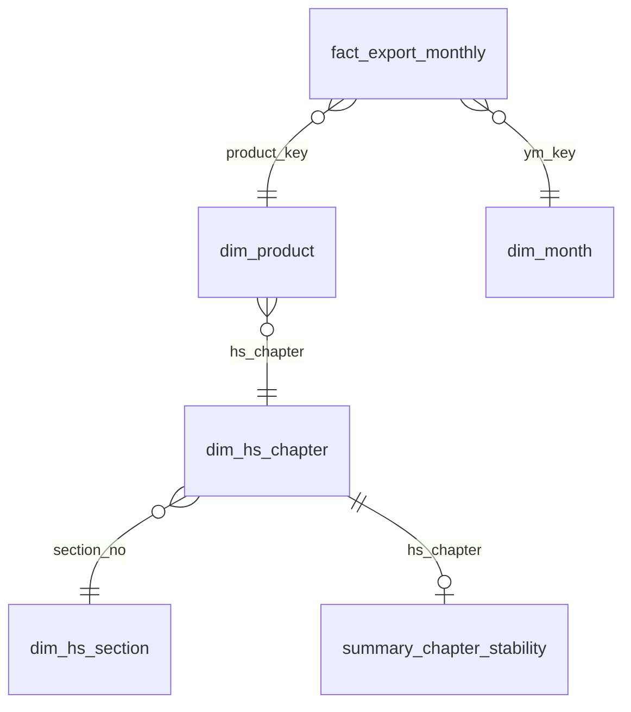

# วิเคราะห์มูลค่าส่งออกของไทยรายเดือนตามพิกัดศุลกากร (HS Code) ปี พ.ศ. 2564
*Thailand Export Analysis by HS Code, 2021*

> **สรุปสั้น**: โปรเจกต์วิเคราะห์ข้อมูลครบวงจรจากมูลค่าส่งออกรายเดือนของไทยปี 2564 ตามพิกัดศุลกากร 8 หลัก (ข้อมูลดิบ 101,028 แถว มูลค่ารวม 8.56 ล้านล้านบาท) ผมคลีนข้อมูลด้วย SQL (SQLite) ตามมาตรฐานที่ใช้ซ้ำได้ จัดโครงสร้างเป็น Star Schema สรุปข้อค้นพบ 4 ข้อ และสร้างแดชบอร์ดสำหรับผู้บริหารใน Power BI ตัวเลขทั้งหมดเป็นบาทตามราคาจริงของปีเดียว ข้อจำกัดอยู่ในหัวข้อที่ 9

> ⚠️ **TODO ก่อนเผยแพร่**: ข้อความที่ขึ้นต้นด้วย ⚠️ ต้องกรอกหรือตรวจสอบเอง แล้วลบบรรทัดนี้ทิ้ง

---

## 1. ภาพรวมโปรเจกต์

**โจทย์ที่ต้องการตอบ (สำหรับผู้บริหาร)**
1. หมวดสินค้ากลุ่มใดเป็นตัวขับเคลื่อนมูลค่าส่งออกหลัก
2. มูลค่าส่งออกรายเดือนตลอดปี 2564 โตหรือผันผวน และไตรมาสใดสูงสุด/ต่ำสุด
3. กลุ่มสินค้าใดสม่ำเสมอทุกเดือน และกลุ่มใดแกว่งตามฤดูกาลหรือรอบการส่งมอบ

**สิ่งที่ส่งมอบ**: ข้อมูลที่คลีนแล้ว, สคริปต์ SQL พร้อมคอมเมนต์ภาษาไทย, โมเดลข้อมูลสำหรับ Power BI, Insight 4 ข้อ, Dashboard 1 หน้า

## 2. ข้อมูล

| รายการ | รายละเอียด |
|---|---|
| ไฟล์ | `exportvalueperhscode64.csv` (UTF-8 มี BOM, 101,028 แถว × 7 คอลัมน์) |
| ช่วงเวลา | ปี พ.ศ. 2564 (ค.ศ. 2021) เดือน 1–12 |
| มูลค่ารวม | 8,563,459,237,207 บาท |
| แหล่งที่มา | ⚠️ ระบุหน่วยงาน ชื่อชุดข้อมูล ลิงก์ และวันที่ดาวน์โหลด |
| สิทธิ์การใช้ข้อมูล | ⚠️ ตรวจเงื่อนไข/ใบอนุญาตของแหล่งข้อมูล ถ้าไม่ชัดเจนอย่า commit ไฟล์ดิบ ให้ใส่ขั้นตอนดาวน์โหลดแทน |

**พจนานุกรมข้อมูล (ไฟล์ดิบ)**

| คอลัมน์ | ความหมาย |
|---|---|
| ปีแม่แบบ | ปี พ.ศ. |
| เดือนแม่แบบ | เดือน 1–12 |
| พิกัดศุลกากร 8 หลัก | รหัสสินค้า HS 8 หลัก (เก็บเป็นข้อความเพื่อรักษาเลขศูนย์นำหน้า) |
| รหัสสถิติ | รหัสย่อย 3 หลัก (บางพิกัดมีหลายรหัส) |
| คำอธิบายไทย / คำอธิบาย | ชื่อสินค้าภาษาไทย / อังกฤษ |
| มูลค่าส่งออกเงินบาท | มูลค่าส่งออกเป็นบาท (ราคาตามจริง ไม่ปรับเงินเฟ้อ) |

⚠️ ระบุนิยามมูลค่า (เช่น FOB หรือไม่) ตามเอกสารของแหล่งข้อมูล

## 3. เครื่องมือ
SQLite (DB Browser for SQLite), SQL (window functions, CTE), Power BI Desktop (DAX), Git/GitHub
⚠️ ใส่เฉพาะเครื่องมือที่ใช้จริงและอธิบายได้ในการสัมภาษณ์

## 4. ขั้นตอนการทำงาน
`ตรวจข้อมูลดิบ → คลีน (SQL) → จำลองข้อมูลแบบ Star Schema → วิเคราะห์ → สร้าง Dashboard → ตรวจสอบความถูกต้อง`

## 5. การทำความสะอาดข้อมูล (มาตรฐานคลีน v1.2)

| ปัญหาที่พบ | จำนวน | วิธีจัดการ |
|---|---|---|
| ช่องว่างนำหน้าในรหัส (พิกัด, รหัสสถิติ) | 101,028 แถว | ตัดช่องว่าง เก็บเป็น TEXT |
| ช่องว่างหัวท้ายในชื่อ | ไทย 4,105 / อังกฤษ 3,480 | ตัดช่องว่าง |
| ช่องว่างซ้อนในชื่อ | ไทย 1,637 / อังกฤษ 1,171 | ยุบเหลือช่องเดียว |
| non-breaking space | ไทย 36 / อังกฤษ 537 | แปลงเป็นช่องว่างปกติ |
| ชื่ออังกฤษต่างกันเฉพาะตัวพิมพ์ | 12 กลุ่ม (หลังจัดการช่องว่าง) | ปรับเป็น sentence case เฉพาะกลุ่มที่ซ้ำ |
| คีย์ซ้ำ (ปี+เดือน+พิกัด+รหัสสถิติ) | 11 แถวเกิน | รวมด้วย SUM ไม่ลบทิ้ง |
| อักษรไทยปนในชื่ออังกฤษ | 14 แถว | แก้ทีละกรณี (`ฐ C` → `°C`, `หรือ` → `or`) |
| มูลค่า 0 และต่ำกว่า 1,000 บาท | 32 / 2,571 แถว | เก็บไว้ ให้กรองตอนวิเคราะห์ |

**ผลตรวจหลังคลีน**: 101,028 → **101,017 แถว** (ลดลงเฉพาะแถวที่รวมจากคีย์ซ้ำ) มูลค่ารวมก่อน/หลังเท่ากัน คีย์ซ้ำ 0, รหัสผิดรูปแบบ 0, ช่องว่างผิดปกติ 0

## 6. โมเดลข้อมูล (Star Schema)



## 7. ผลวิเคราะห์ (ข้อค้นพบสำคัญ 4 ข้อ)

| # | ข้อค้นพบ | ตัวเลขหลัก | ข้อเสนอ |
|---|---|---|---|
| 1 | ฐานมูลค่าหลักนิ่งทั้งปี | 14 จาก 17 หมวดหลัก (สัดส่วน ≥ 1%) นิ่ง รวม 73.0% (6.25 ล้านล้านบาท); 5 หมวดแรก (84, 85, 87, 40, 39) = 56.8% | ตั้งแดชบอร์ดติดตามรายเดือนพร้อมเกณฑ์แจ้งเตือน |
| 2 | มีแค่ผลไม้ที่แกว่งรายเดือนชัดเจน | ผลไม้ (08) สูงสุด พ.ค. 34.2 vs ต่ำสุด มี.ค. 6.1 พันล้านบาท (5.6 เท่า); หมวดอื่นที่ดูผันผวนส่วนใหญ่เป็นแนวโน้มขาขึ้น | แยกพยากรณ์ผลไม้ด้วยปฏิทินรายเดือน |
| 3 | พึ่งรายการเดี่ยวสูง | 3 พิกัดแรกรวม 678.5 พันล้านบาท (7.9%); CV ระดับรายการ 0.14–0.27 | ทำรายการเฝ้าติดตามระดับพิกัด 8 หลัก |
| 4 | โตต่อเนื่อง Q4 สูงสุด Q1 ต่ำสุด | ม.ค. 588.8 → ธ.ค. 826.4 พันล้านบาท (+40.4%); Q1 1.90 → Q4 2.36 ล้านล้านบาท; 90 จาก 96 หมวดโต | ใช้มูลค่าต่อวันและเป้ารายไตรมาส |

รายละเอียดเต็ม (หลักฐาน เหตุผล ข้อจำกัด) อยู่ที่ `docs/insights.md` ⚠️ (ต้องสร้างไฟล์นี้)

## 8. แดชบอร์ด Power BI

⚠️ ใส่ภาพหน้าจอ `docs/images/dashboard.png` (และลิงก์ Power BI ที่เผยแพร่ ถ้ามี)

องค์ประกอบ: การ์ดสรุป 4 ใบ, แนวโน้มรายเดือน, Top 10 หมวด, Heatmap รายเดือน, ส่วนเพิ่ม Q4−Q1, ตาราง 10 พิกัดสูงสุด, ตัวกรองหมวดใหญ่/หมวดสินค้า/ไตรมาส/กลุ่มความสม่ำเสมอ

## 9. ข้อจำกัดและสมมติฐาน
- ข้อมูลปีเดียว แยกแนวโน้ม ฤดูกาล และผลจากเหตุการณ์ภายนอกไม่ได้
- มูลค่าเป็นบาทตามราคาจริง ไม่ได้แยกผลของราคาและอัตราแลกเปลี่ยน ไม่มีข้อมูลปริมาณ
- ไตรมาสเป็นแบบปฏิทิน (Q4 = ต.ค.–ธ.ค.) ไม่ใช่ปีงบประมาณ
- กลุ่มความสม่ำเสมอใช้ CV หลังตัดแนวโน้มเชิงเส้น เกณฑ์ 0.15/0.25 และการตัดที่ 1% เป็นเกณฑ์ที่ตั้งเอง
- ชื่อ Chapter ภาษาไทยเป็นการสรุปโดยย่อ ⚠️ ตรวจกับตารางพิกัดอัตราศุลกากรทางการ
- "มูลค่าส่งออก" ไม่ใช่รายได้ของกรมศุลกากร

## 10. สิ่งที่จะทำต่อ
- เพิ่มข้อมูลปีอื่น เพื่อเทียบรายปีและแยกฤดูกาลออกจากแนวโน้ม
- ตัดผลอัตราแลกเปลี่ยนและราคา (ถ้าหาข้อมูลได้)
- เพิ่มมิติประเทศปลายทาง (ถ้ามีข้อมูล)

## 11. วิธีรันซ้ำ
1. สร้างฐานข้อมูล SQLite ใหม่ แล้วรัน `sql/01_clean_export_hscode.sql` ข้อ 0 เพื่อสร้างตาราง `export_raw`
2. นำเข้า `data/raw/exportvalueperhscode64.csv` ลงตาราง `export_raw` (ข้ามแถวหัวตาราง, ทุกคอลัมน์เป็น TEXT)
3. รันส่วนที่เหลือของ `01_clean_export_hscode.sql` ตามด้วย `02_powerbi_prep_export64.sql`
4. ส่งออกตารางเป็น CSV (UTF-8) แล้วเปิด `powerbi/dashboard.pbix`

⚠️ ลองรันตามขั้นตอนนี้บนเครื่องใหม่ก่อนเผยแพร่ แล้วแก้ขั้นตอนให้ตรงกับที่ทำได้จริง

## 12. โครงสร้างโฟลเดอร์
```
.
├─ README.md
├─ data/
│  ├─ raw/            # ไฟล์ดิบ (ถ้าลิขสิทธิ์อนุญาต)
│  ├─ clean/          # exportvalueperhscode64_clean.csv
│  └─ powerbi/        # fact_*, dim_*, summary_*
├─ sql/               # 01_clean_export_hscode.sql, 02_powerbi_prep_export64.sql
├─ powerbi/           # dashboard.pbix, measures.dax
├─ docs/              # insights.md, cleaning_standard_v1.2.md, images/
└─ LICENSE
```

## 13. สิ่งที่ได้เรียนรู้
⚠️ เขียนเอง 3–4 บรรทัดตามความจริง เช่น ปัญหาที่เจอตอนนำเข้า CSV ภาษาไทย วิธีตรวจว่าคลีนแล้วไม่กระทบยอดรวม และสิ่งที่ผิดพลาดแล้วแก้ (ตัวอย่าง: ตรวจพบว่าหมวดที่ดูผันผวนส่วนใหญ่มาจากแนวโน้ม จึงปรับวิธีจัดกลุ่ม)

## 14. ผู้จัดทำ
⚠️ ชื่อ, ลิงก์ LinkedIn/อีเมล
