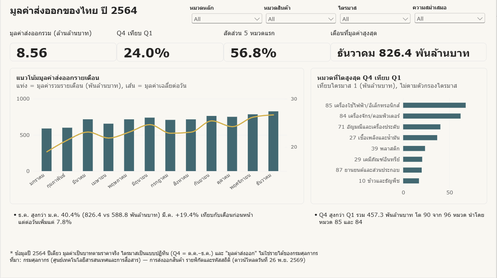
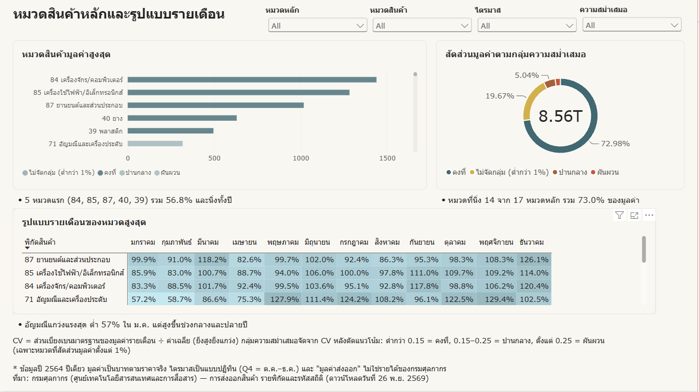
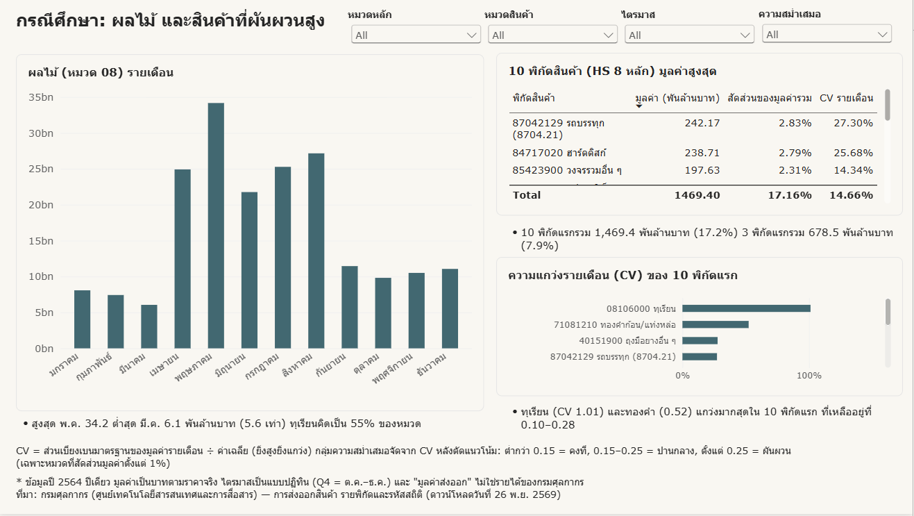

# วิเคราะห์มูลค่าส่งออกของไทยปี 2564 ตามพิกัดศุลกากร (HS Code)

> วิเคราะห์มูลค่าส่งออกรายเดือนของไทย 101,028 แถว มูลค่ารวม 8.56 ล้านล้านบาท ตั้งแต่คลีนข้อมูลด้วย SQL จัดโครงสร้างแบบ Star Schema ไปจนถึงสร้าง Dashboard ใน Power BI เพื่อตอบคำถามว่า "สินค้ากลุ่มไหนขับเคลื่อนการส่งออก และกลุ่มไหนผันผวน"

## Dashboard

## ข้อค้นพบสำคัญ

1. **ฐานมูลค่าหลักนิ่งทั้งปี** 5 หมวดแรก (เครื่องจักร อุปกรณ์ไฟฟ้า ยานยนต์ ยาง พลาสติก) คิดเป็น 56.8% ของมูลค่าส่งออกทั้งหมด
2. **ผลไม้ (หมวด 08)** ผันผวนรายเดือนสูงสุดในหมวดหลัก สูงสุด พ.ค. สูงกว่าต่ำสุด มี.ค. 5.6 เท่า โดยทุเรียนคิดเป็น 55% ของหมวด รูปแบบนี้สอดคล้องกับสินค้าเกษตรตามฤดูกาล
3. **ไม่พึ่งพาสินค้ารายการเดียว** 3 พิกัดแรกรวมกัน 7.9% ของมูลค่าทั้งหมด
4. **มีแนวโน้มสูงขึ้นตลอดปี**  Q4 (2.36 ล้านล้านบาท) สูงกว่า Q1 (1.90) อยู่ 24.0%

รายละเอียดและหลักฐาน: [`docs/insights.md`](docs/insights.md)

## ข้อมูลและเครื่องมือ

- **ข้อมูล:** มูลค่าส่งออกรายเดือนปี 2564 ตามพิกัดศุลกากร 8 หลัก — ชื่อไฟล์: `exportvalueperhscode64.csv` | หน่วยงาน: กรมศุลกากร (ฝ่ายงานที่ติดต่อ: ศูนย์เทคโนโลยีสารสนเทศและการสื่อสาร) | แหล่งที่มา: [data.go.th (`ctm_06_02`)](https://data.go.th/dataset/ctm_06_02) | ดาวน์โหลดเมื่อ: `24/11/2569` (2026-11-24)
- **เครื่องมือ**: SQLite, SQL (window functions, CTE), Power BI (DAX), Git/GitHub

## วิธีทำโดยย่อ

`ตรวจข้อมูลดิบ → คลีนด้วย SQL → Star Schema → วิเคราะห์ → Dashboard → ตรวจความถูกต้อง`

- ตัดช่องว่างผิดปกติในชื่อสินค้าหลายพันแถว
- รวมคีย์ซ้ำ 11 แถวด้วย SUM แทนการลบทิ้ง เพื่อไม่ให้มูลค่าหาย
- เก็บรหัส HS เป็นข้อความเพื่อรักษาเลขศูนย์นำหน้า
- ตรวจแล้วมูลค่ารวมก่อนและหลังคลีนเท่ากัน

## ข้อจำกัด

- ข้อมูลปีเดียว แยกแนวโน้มออกจากฤดูกาลไม่ได้
- เป็นมูลค่าบาทตามราคาจริง ไม่ได้แยกผลของราคาและอัตราแลกเปลี่ยน และไม่มีข้อมูลปริมาณ
- ข้อมูลปี 2564 ปีเดียว มูลค่าเป็นบาทตามราคาจริง ไตรมาสเป็นแบบปฏิทิน (Q4 = ต.ค.–ธ.ค.) และ "มูลค่าส่งออก" ไม่ใช่รายได้ของกรมศุลกากร
ที่มา: กรมศุลกากร (ศูนย์เทคโนโลยีสารสนเทศและการสื่อสาร) — การส่งออกสินค้า รายพิกัดและรหัสสถิติ (ดาวน์โหลดวันที่ 26 พ.ย. 2569)

## วิธีรันซ้ำ

1. สร้างฐานข้อมูล SQLite ใหม่ แล้วรัน [clean_export_hscode.sql](sql/clean/clean_export_hscode.sql) ข้อ 0 เพื่อสร้างตาราง export_raw
2. นำเข้า [exportvalueperhscode64.csv]([data/raw/exportvalueperhscode64.csv](https://data.go.th/dataset/ctm_06_02)) ลงตาราง export_raw (ข้ามแถวหัวตาราง, ทุกคอลัมน์เป็น TEXT)
3. รันส่วนที่เหลือของ [clean_export_hscode.sql](sql/clean/clean_export_hscode.sql) ตามด้วย [powerbi_prep_export64.sql](sql/powerbi_prep/powerbi_prep_export64.sql)
4. ส่งออกตารางเป็น CSV (UTF-8) แล้วเปิด [exportvalueperhscode64_dashboard](powerbi/exportvalueperhscode64_dashboard.pbix)

## ผู้จัดทำ
กฤษฎิ์ ฉาวชาวนา
