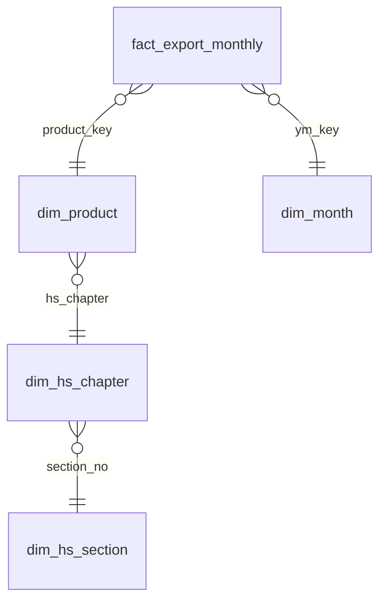

# วิเคราะห์มูลค่าส่งออกของไทยปี 2564 ตามพิกัดศุลกากร (HS Code)
*Thailand Export Analysis by HS Code, 2021*

> **สรุปสั้น**: วิเคราะห์มูลค่าส่งออกรายเดือนของไทย 101,028 แถว มูลค่ารวม 8.56 ล้านล้านบาท ตั้งแต่คลีนข้อมูลด้วย SQL จัดโมเดลแบบ Star Schema ไปจนถึงสรุปข้อค้นพบและสร้างแดชบอร์ดใน Power BI เพื่อตอบคำถามผู้บริหารว่า "สินค้ากลุ่มไหนขับเคลื่อนการส่งออก และกลุ่มไหนผันผวน"
>
> **EN**: End-to-end analysis of Thailand's 2021 monthly export values (101K rows, THB 8.56T): SQL cleaning (SQLite), star-schema modeling, and an executive Power BI dashboard.

## แดชบอร์ด

⚠️ 

## ข้อค้นพบสำคัญ

1. **ฐานมูลค่าหลักนิ่งทั้งปี**: 5 หมวดแรก (เครื่องจักร, อุปกรณ์ไฟฟ้า, ยานยนต์, ยาง, พลาสติก) คิดเป็น 56.8% ของมูลค่าส่งออกทั้งหมด
2. **ผลไม้เป็นกลุ่มเดียวที่แกว่งตามฤดูกาลชัดเจน**: สูงสุดเดือน พ.ค. ต่ำสุดเดือน มี.ค. ต่างกัน 5.6 เท่า
3. **พึ่งพารายการเดี่ยวค่อนข้างสูง**: 3 พิกัดแรกรวมกัน 7.9% ของมูลค่าทั้งหมด
4. **มูลค่าสูงขึ้นต่อเนื่องตลอดปี**: ไตรมาส 4 (2.36 ล้านล้านบาท) สูงกว่าไตรมาส 1 (1.90 ล้านล้านบาท)

**ข้อเสนอเชิงธุรกิจ**: ตั้งแดชบอร์ดติดตามรายเดือนพร้อมเกณฑ์แจ้งเตือน, พยากรณ์ผลไม้แยกด้วยปฏิทินรายเดือน, และทำรายการเฝ้าติดตามระดับพิกัด 8 หลัก

📄 รายละเอียดและหลักฐานเต็ม: [`docs/insights.md`](docs/insights.md)

## ข้อมูลและเครื่องมือ

- **ข้อมูล**: มูลค่าส่งออกรายเดือนปี 2564 ตามพิกัดศุลกากร 8 หลัก ⚠️ (ระบุหน่วยงาน, ชื่อชุดข้อมูล, ลิงก์, วันที่ดาวน์โหลด)
- **เครื่องมือ**: SQLite, SQL (window functions, CTE), Power BI (DAX), Git/GitHub

## วิธีทำโดยย่อ

`ตรวจข้อมูลดิบ → คลีน (SQL) → Star Schema → วิเคราะห์ → Dashboard → ตรวจความถูกต้อง`

**ไฮไลต์การคลีนข้อมูล** (ยอดรวมก่อน/หลังคลีนเท่ากัน)
- ตัดช่องว่างผิดปกติและแปลง non-breaking space ในชื่อสินค้าหลายพันแถว
- รวมคีย์ซ้ำ 11 แถวด้วย SUM แทนการลบทิ้ง เพื่อไม่ให้มูลค่าหาย
- รักษาเลขศูนย์นำหน้าของรหัส HS โดยเก็บเป็นข้อความ
- 101,028 → 101,017 แถว



📄 รายละเอียดเต็ม: [`docs/cleaning_standard_v1.2.md`](docs/cleaning_standard_v1.2.md)

## ข้อจำกัด

- ข้อมูลปีเดียว แยกแนวโน้มออกจากฤดูกาลไม่ได้
- เป็นมูลค่าบาทตามราคาจริง ไม่ได้แยกผลของราคาและอัตราแลกเปลี่ยน และไม่มีข้อมูลปริมาณ
- เกณฑ์จัดกลุ่มความสม่ำเสมอ (CV) เป็นเกณฑ์ที่ผมตั้งเอง

## วิธีรันซ้ำ

1. สร้างฐานข้อมูล SQLite แล้วรัน `sql/01_clean_export_hscode.sql` (ข้อ 0) เพื่อสร้างตาราง `export_raw`
2. นำเข้า CSV ดิบ แล้วรันส่วนที่เหลือของ `01_...` ตามด้วย `02_powerbi_prep_export64.sql`
3. เปิด `powerbi/dashboard.pbix`

```
├─ data/      ├─ sql/      ├─ powerbi/      └─ docs/
```

## สิ่งที่ได้เรียนรู้

⚠️ เขียนเอง 3–4 บรรทัด (เช่น ปัญหาตอนนำเข้า CSV ภาษาไทย, วิธีตรวจว่าคลีนแล้วยอดรวมไม่เพี้ยน, สิ่งที่ผิดแล้วแก้)

## ผู้จัดทำ

⚠️ ชื่อ · LinkedIn · อีเมล
